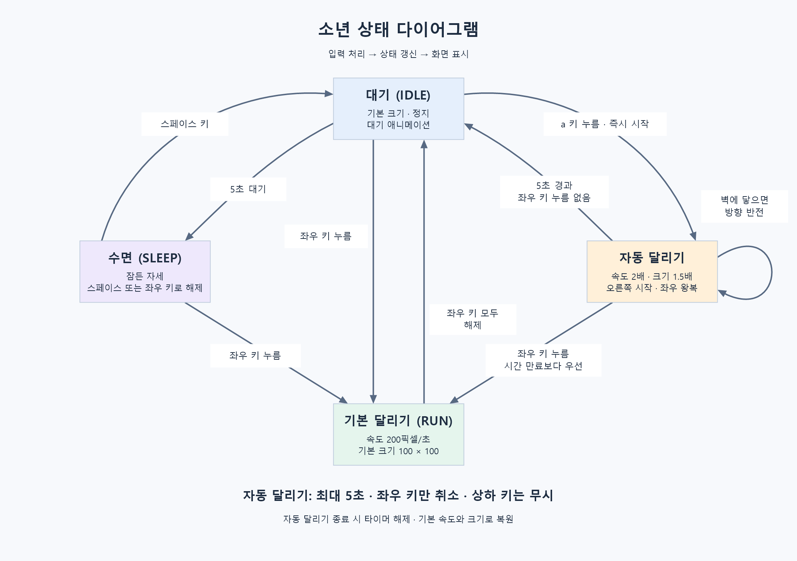

# Drill-11 — 소년 자동 달리기

`prompt/AI_PRD.md`에 따라 기존 대기·수면·달리기 상태에 자동 달리기를 추가한 pico2d 프로젝트이다. 주요 구현은 `Script/main.py`에 있다.

## 실행

Python 3.11 환경에서 프로젝트 루트를 기준으로 실행한다.

```powershell
python -m pip install -r requirements.txt
python Script/main.py
```

`pico2d`와 `transitions`가 이미 설치되어 있으면 바로 실행할 수 있다. 이미지 경로는 소스 위치를 기준으로 계산하므로 작업 폴더가 달라도 실행할 수 있다.

## 조작

| 상태 / 입력 | 동작 |
| --- | --- |
| 대기 중 `a` | 오른쪽으로 자동 달리기 시작 |
| 자동 달리기 중 입력 없음 | 화면 양 끝에서 방향을 바꾸며 최대 5초 동안 왕복 |
| 자동 달리기 중 좌우 방향키 | 자동 달리기를 취소하고 해당 방향으로 기본 달리기 |
| 기본 달리기 중 좌우 방향키 해제 | 다른 좌우 키가 눌려 있지 않으면 대기로 복귀 |
| 대기 상태에서 5초 경과 | 기존 수면 상태로 전환 |
| 수면 중 스페이스 / 좌우 방향키 | 각각 대기 / 기본 달리기로 전환 |
| Escape 또는 창 닫기 | 프로그램 종료 |

자동 달리기는 기본 속도 200픽셀/초의 **2배인 400픽셀/초**, 기본 크기 100×100의 **1.5배인 150×150**을 사용한다. 확대된 캐릭터 전체를 기준으로 화면 경계를 계산한다.

자동 달리기의 5초 만료와 좌우 키 누름이 겹치면 키 입력을 먼저 처리하여 기본 달리기로 전환한다. 상하 키는 자동 달리기를 취소하지 않으며, 자동 달리기 중 `a`를 다시 눌러도 타이머를 연장하지 않는다. 종료 시 자동 달리기 타이머를 해제하고 기본 속도와 크기로 돌아간다.

## 구현 구성

- `Script/main.py`: 실행 루프, 월드 처리, 개별 `AutoRunState` 클래스와 기존 `Boy`를 확장한 `AutoRunBoy` 클래스.
- `Script/boy.py`: 기존 `IDLE`, `SLEEP`, `RUN` 동작. 이미지 경로를 실행 위치와 무관하게 처리하도록 보완했다.
- `Script/grass.py`: 기존 배경 표시와 이미지 경로 처리.
- `Script/docs/state_diagram.png`: 한국어 상태 다이어그램.



Windows에서 다이어그램을 다시 생성하려면 다음 명령을 실행한다.

```powershell
powershell -NoProfile -ExecutionPolicy Bypass -File Script/docs/render_state_diagram.ps1
```

## 확인 결과

설치된 pico2d 1.5.1과 transitions 0.9.3을 사용해 다음 동작을 확인했다.

- 오른쪽 시작, 초당 400픽셀 이동, 150×150 표시.
- 양쪽 경계의 방향 반전과 긴 프레임에서 여러 차례 벽을 지나는 이동량 처리.
- 5초 만료 후 IDLE 복귀, 타이머 정리, 재진입 시 새 타이머 시작.
- 5초 만료와 좌우 키 입력이 겹칠 때 RUN 전환 우선, 기본 속도 복원과 키 해제 처리.
- 상하 키 및 자동 달리기 중 `a` 재입력 처리, 기존 수면·기본 달리기 동작.
- 실행 폴더와 무관한 실제 이미지 로딩, SDL 렌더링 및 종료 처리.

검증은 창을 표시하지 않는 SDL 환경과 제어된 시간·입력으로 진행했고, 렌더링 결과 이미지도 확인했다. 실제 키보드로 조작하는 수동 검수는 별도로 할 수 있다.

개발 과정은 한국어 제목과 설명을 갖춘 15개 커밋으로 기록했다.
